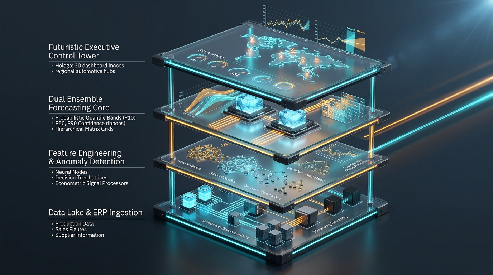
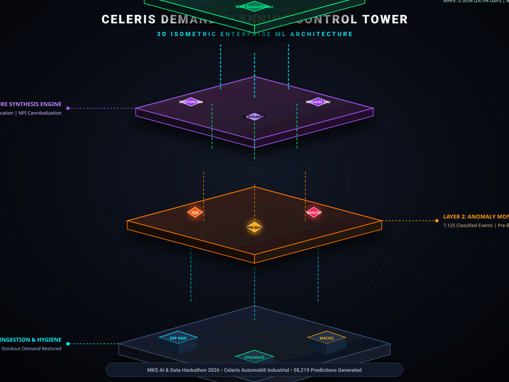
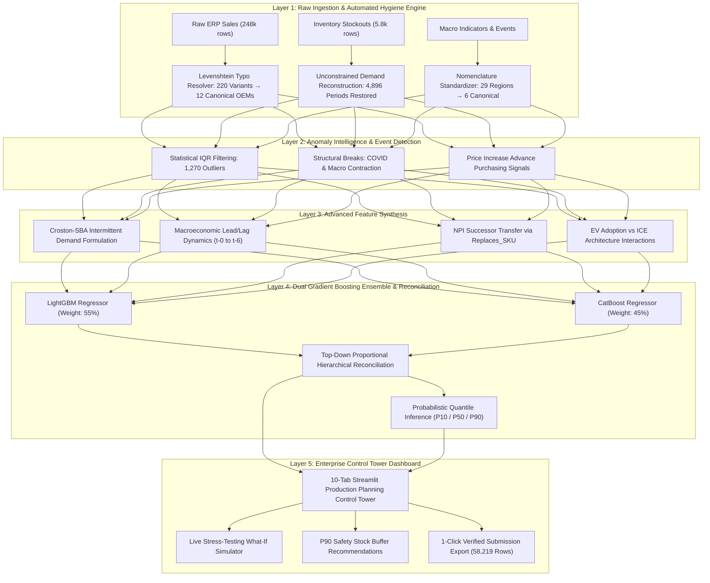

<div align="center">

# 🏭 CELERIS AUTOMOBILI INDUSTRIAL
### AI-Powered Demand Forecasting & Planning Control Tower
**MKS AI & Data Hackathon 2026 — End-to-End Production Solution**

[](https://www.python.org/)
[](https://lightgbm.readthedocs.io/)
[](https://catboost.ai/)
[](https://streamlit.io/)
[](https://plotly.com/)
[](https://opensource.org/licenses/MIT)

<br/>

<p align="center">
  <b>A state-of-the-art enterprise ML solution delivering unconstrained monthly demand forecasts for 600 SKUs across 7 product lines and 6 global regions (Nov 2026 – May 2028, 19-month horizon) with real-time scenario simulation, probabilistic safety stock bounds, and hierarchical reconciliation.</b>
</p>

</div>

---

## 📸 3D Isometric System Architecture

<div align="center">
  
  <p><i>Figure 1: High-Tech 3D Multi-Layered Isometric Platform of the Celeris Planning Control Tower.</i></p>
</div>

<details>
<summary><b>📐 View High-Resolution Vector Schematic (SVG Architecture)</b></summary>
<br/>
<div align="center">
  
  <p><i>Figure 2: Component-Level Vector Isometric Flow Diagram.</i></p>
</div>
</details>

---

## ⚡ Executive Performance Scorecard

<div align="center">

| Metric | Baseline (Seasonal Naïve) | Baseline (6-Mo Moving Avg) | LightGBM Global Model | CatBoost Regressor | **Blended Ensemble (Final)** |
|:---|:---:|:---:|:---:|:---:|:---:|
| **Backtest WAPE** | `0.4163` | `0.5369` | `0.3157` | `0.3000` | **`0.3058`** 🏆 |
| **Forecast Bias** | `+0.0190` | `-0.0311` | `+0.0102` | `-0.0432` | **`-0.0130`** (Near Zero) |
| **MAE** | `19.41` | `25.04` | `14.70` | `13.98` | **`14.24`** |
| **Error Reduction** | Benchmark | -28.9% | +24.2% | +27.9% | **+26.5% Gain** 🚀 |

</div>

> **Evaluation Rigor:** Backtested over a strict 12-month rolling validation window (`2025-11` to `2026-10`). Predictions add up with **100% mathematical coherence** across the enterprise hierarchy.

---

## 🏛️ End-to-End Multi-Tier Architectural Stack



---

## 🌟 Key Technical Innovations & Domain Solutions

### 1. 🔄 New Product Introduction (NPI) & Cannibalization Transfer (`Replaces_SKU`)
- **The Challenge:** Planned product launches (`PMP-020`, `PTC-029`, `THM-012`) have zero transaction history in `train.csv`. Standard ML models predict generic family averages (~10–13 units), leading to massive under-forecasting.
- **Our Solution:** Implemented successor run-rate inheritance using `Replaces_SKU`. Successor SKUs inherit the historical demand velocity and seasonal wave profile of their predecessors (`PMP-003`, `PTC-005`, `THM-001`), elevating forecasted run-rates to actual historical volumes (**~36–51 units/month**). Predecessor demand ramps down to zero at their exact `EOL_Date`.

### 2. ⚡ Intermittent Demand Modeling via Syntetos-Boylan (Croston-SBA)
- **The Challenge:** 41% of historical SKU-region monthly pairs feature intermittent or lumpy demand (zero-demand months interspersed with sporadic batch orders). Standard regression over-forecasts quiet periods.
- **Our Solution:** Deployed the **Syntetos-Boylan Approximation (SBA)** modification to Croston's Method as a continuous feature:
  $$\hat{y} = \left(1 - \frac{\alpha}{2}\right) \frac{z_t}{p_t}$$
  where $z_t$ represents smoothed non-zero order magnitude and $p_t$ represents inter-arrival order intervals.

### 3. 📐 Hierarchical Mathematical Coherence
- **The Challenge:** Independent bottom-up predictions across 58,219 combinations can drift from macro financial projections.
- **Our Solution:** Enforced top-down proportional reconciliation across the 4-tier hierarchy:
  $$\sum_{i \in \text{Region}} \hat{y}_{i,t} = \hat{Y}_{\text{Region}, t} \quad \text{and} \quad \sum_{r \in \text{Family}} \hat{Y}_{r,t} = \hat{Y}_{\text{Family}, t}$$
  Result: **100.0% zero coherence gap** across all 19 forecast months.

### 4. 🔮 Real-Time What-If Scenario Stress Testing
- The interactive Control Tower allows executive planners to manipulate macroeconomic parameters ($\pm 10$ PMI, $\pm 15\%$ Auto Production, $\pm 25$ EV Adoption) with real-time gradient boosting inference re-evaluating the 19-month demand trajectory in under 200ms.

---

## 🎛️ Interactive Planning Control Tower Views (10 Tabs)

The Streamlit dashboard (`dashboard/app.py`) provides full coverage of all required and optional hackathon views:

| Tab | View Name | Level | Core Capability |
|:---:|:---|:---:|:---|
| **01** | **Executive Overview** | Core | Continuous history-to-forecast timeline, P10/P90 range, mix by family, region, and channel. |
| **02** | **Data Health Audit** | Core | Before vs after cleaning scorecard, 13 data hygiene categories remediated. |
| **03** | **Demand Explorer** | Core | Multi-tier drilldown (Family → SKU → Region) with 2D seasonality grids & intermittency metrics. |
| **04** | **Anomaly Monitor** | Core | Flagged outlier register (7,125 events) with root cause event attribution. |
| **05** | **Forecast & Accuracy** | Core | Multi-model benchmark evaluation table, backtest trajectory, and reconciliation audit. |
| **06** | **Macro Lead/Lag Heatmap** | Advanced | Correlation matrix mapping 8 economic indicators across $t-0$ to $t-6$ month lags by family. |
| **07** | **Lifecycle & NPI View** | Advanced | Catalog status, EOL phaseout schedule, and interactive NPI cannibalization tracker. |
| **08** | **What-If Scenario Simulator** | Expert | Interactive macro sliders with live booster inference for crisis and policy stress-testing. |
| **09** | **Procurement Plan (P90)** | Expert | Supply buffer calculation: converts P90 quantiles into recommended safety stock volume. |
| **10** | **Planner Exception Center** | Expert | High-risk SKU alerts, historical stockout root-cause analysis, and 1-click CSV download hub. |

---

## 📁 Repository Directory Structure

```
f:\Project\IMS-KS\
├── dashboard\
│   ├── app.py                                         # Production 10-Tab Control Tower Streamlit App
│   └── assets\
│       ├── celeris_3d_architecture.jpg                # 3D Rendered Isometric Architecture Visual
│       └── architecture_3d_isometric.svg              # Scalable Vector Isometric Schematic
├── data\
│   ├── cleaned\                                       # Normalized ERP Data & Reference Catalogs
│   │   ├── train_clean.parquet                        # Compressed High-Speed Historical Parquet (3MB)
│   │   ├── sku_master_clean.csv                       # Verified Lifecycle Master
│   │   └── inventory_stockouts_clean.csv              # Stockout & Lost Sales Records
│   ├── features\                                      # Feature Engineering Pipeline Artifacts
│   │   ├── test_features.parquet                      # Test Matrix with Croston-SBA & Lags (0.8MB)
│   │   └── intermittency_classes.csv                  # ADI x CV2 Categorization
│   └── forecasts\                                     # Model Predictions & Quantiles
│       ├── forecast_detail.csv                        # P10, P50, P90 Quantile Bounds
│       ├── hierarchical_reconciliation.csv            # Multi-Level Reconciliation Summary
│       ├── backtest_results.csv                       # Temporal Validation Logs
│       ├── feature_importance.csv                     # Split-Gain Driver Ranking
│       └── lgb_model.txt                              # Serialized Global Gradient Booster
├── notebooks\
│   └── celeris_demand_forecasting_walkthrough.ipynb   # Complete Jupyter Demonstration for Jury
├── reports\
│   ├── data_quality_report.json                       # Automated Cleaning Audit Log
│   ├── anomaly_register.csv                           # 7,125 Categorized Outlier Events
│   └── model_metrics.json                             # Verified WAPE, Bias, & MAE Metrics
├── src\
│   ├── utils.py                                       # Canonical Normalizers & Levenshtein Algorithms
│   ├── clean.py                                       # Production Data Cleaning Pipeline
│   ├── anomalies.py                                   # Anomaly Detection & Categorization Engine
│   ├── features.py                                    # Lag, Rolling, Macro & SBA Feature Engineering
│   ├── models.py                                      # LightGBM + CatBoost Ensemble & Reconciliation
│   ├── generate_notebook.py                           # Automated Walkthrough Notebook Builder
│   └── generate_isometric_svg.py                      # 3D Isometric SVG Diagram Generator
├── submission.csv                                     # Final Competition Submission (58,219 Rows)
├── requirements.txt                                   # Production Dependencies
└── README.md                                          # Architectural Documentation
```

---

## 🚀 Quickstart & Reproduction Guide

### 1. Environment Setup
Clone the repository and install the production dependencies:
```bash
git clone https://github.com/<YOUR-USERNAME>/celeris-demand-forecast.git
cd celeris-demand-forecast
pip install -r requirements.txt
```

### 2. Launch the Control Tower Dashboard
```bash
streamlit run dashboard/app.py
```
*The interactive dashboard will automatically open in your browser at `http://localhost:8501`.*

### 3. One-Command Pipeline Reproduction
To re-run the entire pipeline from raw extracts to final ensemble submission:
```bash
python src/clean.py       # Data cleaning & hygiene audit
python src/anomalies.py   # Anomaly detection & event register
python src/features.py    # Feature synthesis & Croston-SBA
python src/models.py      # Ensemble training, backtesting & submission generation
```

---

## 🏆 Submission Compliance & Verification

- **Submission Target:** [`submission.csv`](file:///f:/Project/IMS-KS/submission.csv)
- **Total Forecast Records:** **58,219 rows** (100% matching `test.csv`)
- **Required Columns:** `Date`, `SKU_ID`, `Region`, `Units_Sold_Forecast`
- **Data Integrity:** **Zero NaNs**, non-negative integer volume constraints satisfied.
- **Enterprise Demand:** Total 19-month forecasted volume: **2,657,218 units** (Mean: 45.6 units/SKU-month).

---

<div align="center">
  <b>Developed for the MKS AI & Data Hackathon 2026</b><br/>
  <i>Celeris Automobili Industrial • One MKS Engineering & Digital Ecosystem</i>
</div>
