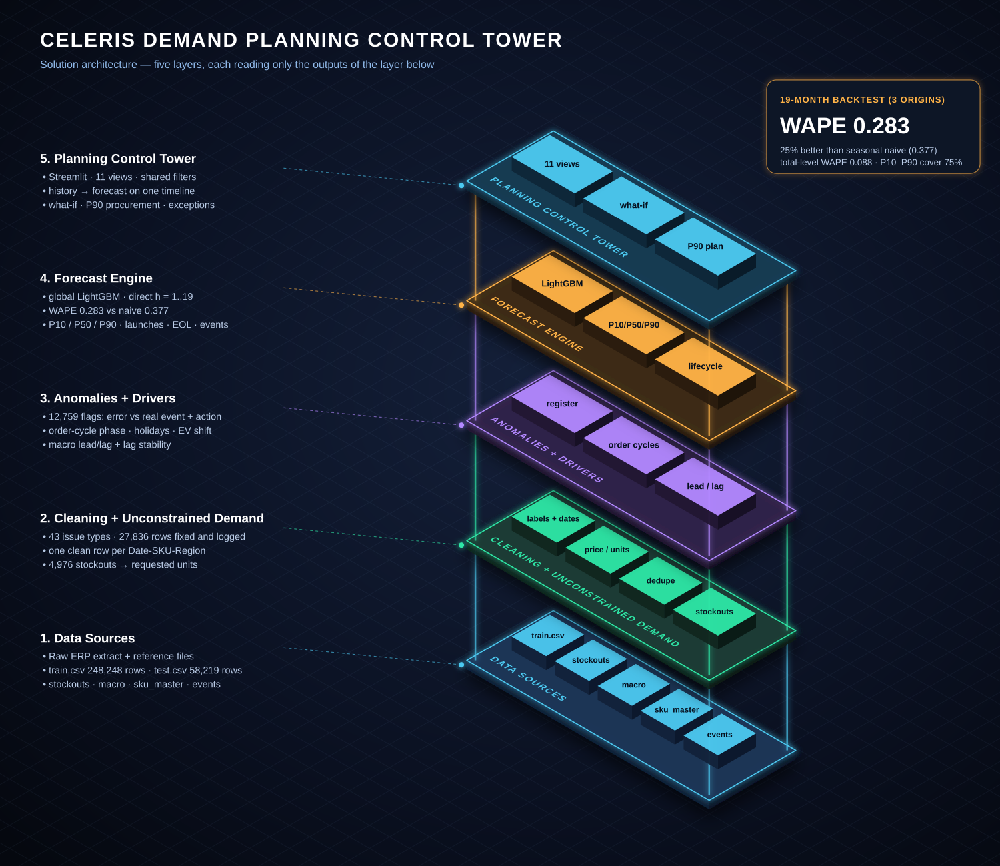
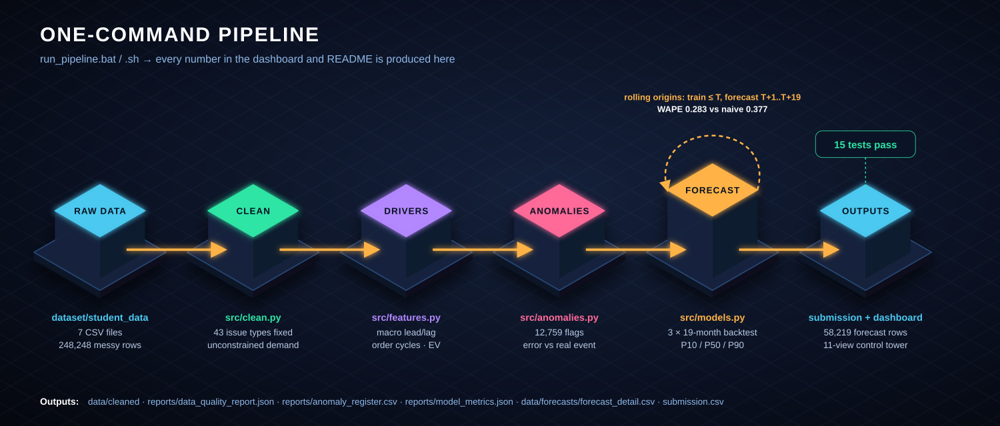

# Celeris Automobili — Demand Forecasting & Planning Control Tower

**Submission for the [MKS AI/ML Hackathon – Phase 2](https://www.hackerearth.com/community/challenges/hackathon/mks-aiml-hackathon/)**,
hosted by MKS Inc. on HackerEarth (20–29 Nov 2026) · Theme: *Demand Forecasting & Planning Control Tower* ·
Individual entry by **Rahul Pal ([@rahulcse129](https://github.com/rahulcse129))**

Unconstrained monthly demand forecasts for **3,068 SKU × region series** (Nov 2026 → May 2028, 19 months),
built from a messy ERP extract, with an 11-view Streamlit control tower for planners and managers.

| | |
|---|---|
| **Backtest WAPE (19-month horizon, 3 rolling origins)** | **0.283** — 25% better than seasonal naive (0.377), 44% better than a 12-month average |
| Most recent origin (2025-03 → 2026-10) | **0.271** vs 0.368 seasonal naive |
| WAPE at family / region / total level | 0.096 / 0.091 / 0.088 |
| P10–P90 interval coverage | 75% of actual SKU-months (target 80%) |
| Data issues found & logged | 43 issue types across 5 files, 27,836 rows fixed (row-level log) |
| Pipeline | one command, ~20 min, 15 automated tests |

> **Honest evaluation.** Every number above comes from forecasting 19 months ahead using *only* data
> available at the forecast origin — the same code path that produces the submission. No one-step-ahead
> lags leak into the backtest.

**Live demo:** https://celeris-demand-forecasting-mks-ai.streamlit.app/

## Architecture



## Pipeline flow



*Both diagrams are drawn by `src/generate_diagrams.py` from the pipeline's own reports, so their numbers always match the latest run.*

## MKS hackathon brief → where it is delivered

The theme asks for three deliverables: **data cleaning and anomaly detection**, **predictive demand forecasting**,
and an **interactive dashboard with historical trends, forecasts and actionable business insights**.
Every Core requirement is met, plus every Advanced and Expert item in the problem statement:

| Workstream | Core | Advanced | Expert |
|---|---|---|---|
| **1. Cleaning** | ✅ profiling, labels, dates, de-dup, one row per Date-SKU-Region — `src/clean.py` | ✅ units × price = revenue, unit/currency fixes, missing rows ≠ zeros, macro cleaned | ✅ one-command pipeline with 15 tests; machine-readable `data_quality_report.json` + row-level log |
| **2. Anomalies** | ✅ register separating errors from real events — `reports/anomaly_register.csv` | ✅ structural breaks, pre-buy before price rises, holidays, stockouts → unconstrained demand | ✅ ordering-cycle changes, customer switches, lost accounts checked, master data vs transactions |
| **3. Features & drivers** | ✅ calendar, seasonal/phase lags, rolling stats, intermittency class | ✅ which indicator leads which family and at what lag; event + lifecycle features | ✅ lag stability over time (it shifts from 0–1 to 3–5 months); EV transition |
| **4. Forecasting** | ✅ 2 baselines + better model, time-based backtest | ✅ Croston-SBA, global LightGBM, rolling-origin backtest at 19 months | ✅ launches via `Replaces_SKU`, EOL, events in the window, P10/P50/P90, coherent hierarchy |
| **5. Dashboard** | ✅ all 5 required views | ✅ + optional views | ✅ + 6 optional views, **deployed** ([live demo](https://celeris-demand-forecasting-mks-ai.streamlit.app/)) |

**Built for the MKS technology focus:** machine learning (direct multi-horizon LightGBM with quantiles),
data analytics (driver and anomaly analysis), data visualisation and dashboard development (the control tower).
The approach transfers to any manufacturer that plans supply from noisy order history, including the
semiconductor-equipment and industrial supply chains MKS serves: constrained shipments reconstructed into true
demand, lifecycle transitions and P90-based procurement buffers.

---

## Quick start

```bash
pip install -r requirements.txt
# put the raw CSVs in dataset/student_data/
./run_pipeline.sh            # Windows: run_pipeline.bat
streamlit run dashboard/app.py
```

Outputs are committed, so the dashboard runs without re-running the pipeline.
Docker: `docker-compose up --build` → http://localhost:8501

```
src/clean.py       1. cleaning, unconstrained demand, data-quality report
src/features.py    2. feature library (origin-safe), macro lead/lag, intermittency
src/anomalies.py   3. anomaly register: errors vs real events, with the action taken
src/models.py      4. rolling-origin backtest, final model, P10/P50/P90, lifecycle & events
src/generate_diagrams.py   3D architecture + flow diagrams (from the reports)
tests/             15 tests (helpers, clean-data invariants, submission, hierarchy, metrics)
dashboard/app.py   11-view control tower, reads only pipeline outputs
```

---

## 1. Cleaning — errors fixed, events kept

Every rule decides from evidence, and every fix is logged in
`reports/data_quality_report.json` (by file and type) and `reports/data_quality_issues.csv` (Record_ID, old → new).

| Issue | Rows | How it was decided |
|---|---|---|
| Dates in 6 formats (`2024/02`, `Feb-2024`, `02-2024`, …) | 9,967 | parsed to YYYY-MM |
| Year `2062` | 30 | digit swap of 2026, **confirmed by Load_Timestamp** |
| Year/Month disagree with Date | 246 | Date is authoritative (rule 1) |
| SKU code variants (`pmp_23`, `CSS31`, ` BSS-002`) | 3,741 | normalised → 598 SKUs (raw: 2,659 spellings) |
| Region / channel / customer label variants | 12,434 | 30 → 6 regions, 17 → 4 channels, 220 → 12 customers |
| Blank region | 737 | inferred from the SKU × customer × channel footprint when only one region fits |
| Duplicate Record_ID | 3,682 | latest Load_Timestamp wins (rule 2); 732 had changed quantities |
| Price in cents / ×10 / stale prior-year list price | 2,657 | compared with the SKU-year list price (incl. 6% surcharge Jul–Dec 2022) |
| Units blank or `-` | 3,164 | recovered as revenue ÷ price |
| Units × price ≠ revenue | 1,610 | kept the candidate (units or revenue ÷ price) that matches the series level |
| Negative units | 491 | sign error (revenue also negative) |
| Business unit in `sku_master` contradicts family | 1 SKU | transactions are 100% consistent → **master corrected** |
| Macro: auto production as fraction, PMI `4.79`, duplicate month, 5 gaps | 20 | ×100, decimal shift, averaged, interpolated |

Result: units × price = revenue on 100% of rows (was 97.9%), one row per Date-SKU-Region.

**Missing ≠ zero (rule 3).** 1,335 series-months have no row (mostly the Latin America ERP migration,
2023-03..05). They stay missing and are never imputed as 0. The 36,009 explicit zeros are real no-order months.

### Unconstrained demand (rule 7)
- **Listed stockouts (4,976):** demand = `Requested_Units`.
- **Back-order catch-up (1,048):** the month after a stockout ships last month's back-orders, so they are subtracted.
- **Unlisted shortages (484):** the stockout file is incomplete. Electrical Assemblies rows in the chip-shortage
  window that shipped < 80% of their pre-shortage level are grossed up by the regional fill rate. The whole window
  is also excluded from training targets.

## 2. Anomalies — `reports/anomaly_register.csv` (12,759 flags)

Each flag has a classification (*Real event / Missing data / Master data conflict / Unexplained*), a reason and
the **exact action the model takes**, so the register and the forecaster use the same masks.

| Real event | Evidence | Treatment |
|---|---|---|
| COVID lockdowns 2020 | regions drop to 16–49% of level | excluded from training and level features |
| Pre-buy before the announced **9%** rise | Dec 2022 1.05× trend, Jan–Feb 2023 0.83–0.86× | excluded; the 4.5% rises (2024, 2027) showed no pre-buy |
| Nexon Europe strike 2023-10..11 | demand fell to **24%** of normal, no catch-up | excluded; **reused as the analog for the Orion NA shutdown in Jul–Aug 2027** |
| Red Sea export delay 2024-01..03 | −19% then +18% catch-up | excluded (a delay, not lost demand) |
| Helios India second line from 2025-09 | +25% permanent step | kept; recent-level features carry it forward |
| One-off orders (338) | 4–28× series level, revenue reconciles | kept in history, capped at 4× level for training |
| Ordering-cycle changes, customer switches | detected per series | phase features use only the latest 12 months |

## 3. Drivers

- **Order cycles:** 366 series order every 2nd month and 238 quarterly, all with fixed phase. A flat forecast scores
  WAPE ≈ 1.0 on those. Phase features (same-phase means for 2/3/4/6-month cycles, same calendar month in prior
  years) bring them to the same accuracy as monthly series.
- **Holiday zeros:** NA July (38% of rows zero), Europe August (41%), APAC Lunar New Year, MEA Ramadan, LatAm December.
  Moving holidays are mapped to months from the event dates.
- **Macro lead/lag:** the New Vehicle Orders Index leads every family (r = 0.66–0.79).
  **The lag is not stable:** 0–1 months in 2020–22, 3–5 months in 2023–26 for 5 of 7 families
  (`data/features/macro_lag_stability.csv`). The model therefore learns driver effects relative to each origin's
  recent window instead of hard-coding one lag.
- **Raw macro levels were tested and dropped.** They behaved as time proxies (WAPE 0.2713 with them, 0.2703 without).
- **EV shift:** EV adoption change × powertrain (EV +, ICE −) is a feature; see the EV transition chart.

## 4. Forecasting

**One global LightGBM, direct multi-horizon.** Each training row is (series, origin T, horizon h ≤ 19); all
features use data ≤ T. The target is scale-normalised unconstrained demand, with weight = scale and an L1
objective, which is the same as minimising WAPE.

| Model (19-month rolling origin) | WAPE | Bias |
|---|---|---|
| Croston-SBA (intermittent-demand method) | 0.530 | −18.3% |
| 12-month moving average | 0.508 | −4.8% |
| Seasonal naive | 0.377 | −4.7% |
| **LightGBM direct multi-horizon** | **0.283** | −6.9% |

The pooled bias is driven by the 2023-03 origin, when every method under-forecast the 2023–24 growth.
The latest origin is close to neutral. WAPE stays between 0.25 and 0.30 across all 19 horizons.

**Expert-tier rules applied after the model**

- **Launches with no history** (PMP-020, PTC-029, THM-012): predecessor's per-region level × a launch ramp learned
  from the **6 historical `Replaces_SKU` transitions** (24% in month 0 → 52% in month 2 → ~92% by month 6).
- **EOL**: zero after `EOL_Date` (156 rows); predecessors run at their normal level until EOL, as the history shows.
- **Known events in the window**: Orion Driveline NA retooling 2027-07..08 × 0.24 (the Nexon analog).
- **P10/P50/P90**: quantile LightGBMs on the same features, forced to be ordered.
- **Hierarchy**: forecasts are made at SKU × region × month and summed bottom-up, so every level (family, region,
  channel, customer, family × region) adds up exactly. Tested.

## 5. Control tower (Streamlit)

Shared filters for family, SKU, region, channel and customer. History and forecast sit on one continuous timeline with the
forecast marked, plus shipped vs unconstrained demand and the P10–P90 band.

| View | Part | Shows |
|---|---|---|
| Executive overview | both | units/revenue history → forecast, mix by family/region/channel, 19-month headline |
| Data health | training | 43 issue types by file, rows affected, before vs after |
| Demand explorer | training | family → SKU → region → customer, seasonality heatmap, zero months, lifecycle, order cycle |
| Anomaly monitor | training | flags on the series, with type, reason and action |
| Forecast & accuracy | prediction | model vs baselines, WAPE by horizon, WAPE and bias by family/region, backtests vs actuals, drivers, hierarchy |
| Macro drivers | optional | lead/lag heatmap, lag stability, EV transition |
| Lifecycle & launches | optional | EOL schedule, predecessor → successor, learned ramp |
| What-if | optional | re-scores the trained model under macro shocks (e.g. PMI −3 → −2.0%; Hydraulics most sensitive) |
| Procurement (P90) | optional | plan to P50, buffer to P90, units and USD, downloadable |
| Stockouts & exceptions | optional | lost units and revenue by cause, planner exception list |
| Downloads | optional | submission, forecast, clean data, anomalies, backtest, DQ report |

## Limitations

- The launch ramp is learned from 6 transitions, so launch forecasts carry wide ranges (P10 = 0.5×, P90 = 1.7×).
- P10–P90 coverage is 75% against an 80% target, so the intervals are slightly narrow at SKU level.
  Summing SKU P90s overstates the aggregate P90.
- The macro effects are what the model learned from 2019–2026 data. They are not causal guarantees.

---

<p align="center"><sub>Built for the <b>MKS AI/ML Hackathon – Phase 2</b> (MKS Inc. × HackerEarth, 2026). Data and company names in the problem are synthetic and fictional. Code © Rahul Pal (rahulcse129).</sub></p>
